# Pipeline Dashboard — telco-revenue-assurance-agent

> Last updated: 2026-11-03 12:57:27

`██████████████░░░░░░░░░░` 57% (4/7 steps)

## 🔀 Pipeline Flow

```mermaid
flowchart LR
    A["rh-qs-discovery"] --> B["rh-qs-architect"] --> C["rh-qs-scaffold"] --> D["rh-qs-implement"] --> E["rh-qs-deploy"] --> F["rh-qs-debug-and-deploy"] --> G["rh-qs-document"]
    style A fill:#d4a017,color:#fff,stroke:#b8860b
    style B fill:#2ea44f,color:#fff,stroke:#1a7f37
    style C fill:#e0e0e0,color:#333,stroke:#bbb
    style D fill:#2ea44f,color:#fff,stroke:#1a7f37
    style E fill:#e0e0e0,color:#333,stroke:#bbb
    style F fill:#2ea44f,color:#fff,stroke:#1a7f37
    style G fill:#e0e0e0,color:#333,stroke:#bbb
```

## 📋 Pipeline Steps

| # | Step | Status | Output | Completed |
|---|------|--------|--------|-----------|
| 1 | rh-qs-discovery | ⚠️ done | [prd.md](../prds/prd.md) (Output not found! Verify outputs manually) | 2026-09-17T13:55:52 |
| 2 | rh-qs-architect | ✅ done | [architecture-spec.yaml](../designs/architecture-spec.yaml) | 2026-09-23T13:23:40 |
| 3 | rh-qs-scaffold | ⏳ pending | — | — |
| 4 | rh-qs-implement | ✅ done | [implementation-manifest.yaml](../pipeline/implementation-manifest.yaml) | 2026-10-26T15:37:30 |
| 5 | rh-qs-deploy | ⏳ pending | — | — |
| 6 | rh-qs-debug-and-deploy | ✅ done | [deploy-state.yaml](../pipeline/deploy-state.yaml) | 2026-11-03T12:57:27 |
| 7 | rh-qs-document | ⏳ pending | — | — |

---

## ⚠️ Review Before Continuing — rh-qs-debug-and-deploy

- deploy-state.yaml exists in [.rhoai-qs/telco-revenue-assurance-agent/.qs-factory/pipeline/deploy-state.yaml](../pipeline/deploy-state.yaml) with overall_status healthy
- Review content: 83/83 expected resources are healthy. The no-cap API image is deployed through a guarded patch to `Deployment/api`; the pod diff confirms exactly one API pod changed and no other pod changed. Phase 5 recorded 1/16 checks passed and 15 skipped; grounded chat is blocked because no authenticated OAuth browser session or independent data/tool gate evidence was available. No new chat POST was sent.
- Read [deploy-report.md](../../../../.tmp/telco-revenue-assurance-agent/debug/deploy-report.md) (local run log, not committed) and [e2e-results.yaml](../../../../.tmp/telco-revenue-assurance-agent/debug/e2e-results.yaml) for the rollout and verification gates
- Hold documentation until a grounded chat response is verified against the deployed API

---

## ⏸ Hold Before Continuing

The API fix is deployed, but chat has not been verified end to end. Use an authenticated OAuth session, confirm the test plan's data/tool prerequisites, and submit a fresh chat request before generating the final quickstart documentation. Retrying the original failed request ID can still hit its existing `in_progress` guard.
