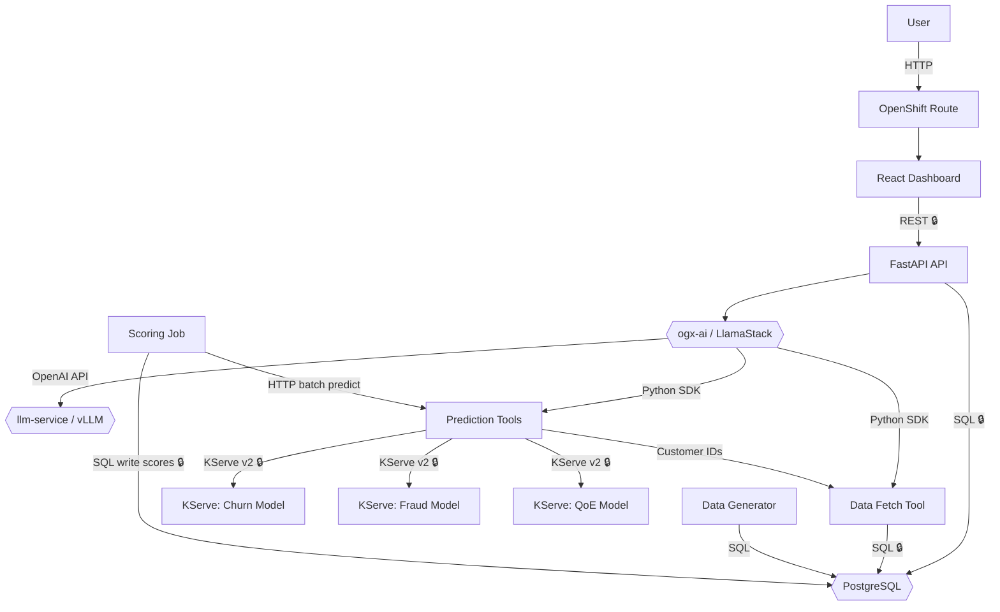

# Detect Telco Revenue Losses with an AI Agent

Detect churn risk, billing fraud, and network QoE issues using a conversational AI agent backed by three ML models on OpenShift® AI.

## Table of Contents

- [Description](#description)
- [Architecture](#architecture)
- [Example Queries](#example-queries)
- [Requirements](#requirements)
- [Deploy](#deploy)
- [Delete](#delete)
- [Troubleshooting](#troubleshooting)
- [Reference](#reference)
- [Tags](#tags)

## Description

This AI quickstart shows how a telecom revenue assurance team can use a conversational AI agent to investigate customer churn risk, billing fraud, and network Quality of Experience (QoE) across customer segments in real time. Rather than running manual SQL queries or switching between dashboards, an analyst asks the agent in plain language and receives model-backed insights in seconds — with the agent deciding autonomously which tools and models to call.

The agent runs on Red Hat® OpenShift AI using LlamaStack with a Llama 3.1 8B Instruct model served by vLLM. It uses a ReAct loop to decide when to query the customer database, when to invoke the churn or fraud prediction models, and when to fetch QoE metrics — combining SQL data retrieval with live ML inference to produce actionable analyst guidance. All three prediction models (churn, fraud/RAFM, and QoE) are served as KServe InferenceServices on Red Hat OpenShift AI, using LightGBM and ONNX runtimes.

A React dashboard gives analysts a high-level regional risk summary and surfaces the same AI agent through a floating chat panel. A FastAPI backend orchestrates communication between the UI, the LlamaStack agent, and a PostgreSQL database populated by a one-off data generator job using synthetic but statistically realistic telco customer, transaction, and network data.

At deployment, a scoring job pre-computes churn, fraud, and QoE predictions for all customers and writes them to the database. The dashboard reads these stored scores to display summary metrics — churn rate, fraud count, and average QoE by region — without hitting the models at runtime. The agent operates on-demand, filtering, slicing, and cross-referencing the same model APIs to answer analyst follow-up questions in real time.

## Architecture



| Component | Role |
|---|---|
| **React Dashboard** | Regional risk metrics + floating AI chat interface |
| **FastAPI Backend** | REST API — routes chat and metrics requests |
| **ogx-ai / LlamaStack** | Agent orchestration and ReAct tool loop |
| **vLLM** | Llama 3.1 8B Instruct on-cluster inference |
| **Data Fetch Tool** | Queries PostgreSQL for customer and transaction data |
| **Prediction Tools** | Wraps KServe Churn, Fraud, and QoE model endpoints |
| **PostgreSQL** | Customer, transaction, and regional QoE data store |
| **Data Generator** | One-off job that populates the database with synthetic telco data |
| **Scoring Job** | One-off batch job that runs churn, fraud, and QoE predictions for all customers and writes scores back to PostgreSQL |
| **KServe Models** | LightGBM (churn), ONNX (fraud/RAFM), ONNX (QoE) |

**Agent tools** called by the ReAct loop:

| Tool | Category | Purpose |
|---|---|---|
| `query_db` | Data | Grouped customer query with churn/fraud/region filters |
| `count_customers` | Data | Count customers matching a single condition |
| `cross_metric_count` | Data | Count customers matching two cross-metric conditions |
| `list_customers` | Data | List individual customers with filters |
| `fetch_customer_data` | Data | Full profile for a specific customer |
| `fetch_transaction_data` | Data | Transaction records for a specific customer |
| `predict_churn` | Prediction | Churn risk score via KServe |
| `predict_fraud` | Prediction | Fraud flag via KServe |
| `predict_qoe` | Prediction | QoE score via KServe |

## Example Queries

The agent reasons across all three models in a single conversation. Below are representative examples using the synthetic dataset included in this quickstart.

### "Why is churn so high in the West?"

The agent queries the database to segment customers by region, runs churn predictions per segment, and finds Region West at 35% churn versus 12% average elsewhere — 870 customers at risk. It then checks QoE for that region (34/100 vs 72 average) and fraud rate (0.5%, same as other regions). Response:

> *"Churn is concentrated in Region West — 35% of customers there are predicted to churn vs 12% average elsewhere. Starlink QoE in that region is 34/100, significantly below the 72 average. Poor satellite coverage correlates with the high churn rate. Fraud rate is normal (~0.5%), so billing issues are not a factor. 870 customers are at risk — consider investigating network coverage or targeting them with retention offers."*

### "Are fraud-flagged customers also churning?"

The agent fetches the fraud-flagged customer list, runs churn predictions on each, and cross-references the results:

> *"66% of fraud-flagged customers are also at churn risk. These may be billing disputes rather than actual fraud — review before blocking accounts."*

### "Which region needs attention first?"

The agent scores QoE across all regions, finds the worst performer, then checks churn and fraud for those customers to build a revenue-at-risk ranking:

> *"Region West is the clear priority: QoE of 34/100 and 35% churn (870 of 2,500 customers), versus 12% churn elsewhere. Only 8 of those 870 also have fraud-flagged transactions, so billing anomalies are not compounding the problem. Poor satellite coverage is the root cause."*

## Requirements

### Hardware

| Node Type | Qty | vCPU | Memory |
|---|---|---|---|
| Control Plane | 3 | 8 | 16 GB |
| Worker | 2 | 16 | 32 GB |
| GPU Worker (optional) | 1 | 16 | 64 GB + 1× NVIDIA A10 / A100 / L40S |

> **GPU note:** A GPU node is required to run the LLM service on-cluster (Step 2). Without one, skip Step 2 and point `ogx-ai` at a remote OpenAI-compatible vLLM endpoint: `make deploy-ogx-ai VLLM_URL=<your-vllm-url>`.

### Software

| Software | Tested version |
|---|---|
| Red Hat OpenShift Container Platform | 4.22 (stable-4.22) |
| Red Hat OpenShift AI | 3.4.2 |
| Kubeflow Pipelines | 2.16.0 |
| KServe | 0.17.0 |
| Helm | 3.14+ |
| `oc` CLI | 4.22 |

### Permissions

| Resource group | Required role |
|---|---|
| Helm charts (`pgvector`, `ogx-ai`, tools, frontend) | Namespace admin |
| KServe manifests (`deploy/serving/`) | Namespace admin + OpenShift AI project member |

### Prerequisites

Before deploying, ensure the following are in place:

- **OCP CLI login** — you are authenticated against the target cluster (`oc whoami` returns your username).
- **OCP internal registry enabled** — the cluster internal registry is running and accessible; required by the `make build-*` targets that push images via `BuildConfig` and `ImageStream`.
- **Object storage** — an S3-compatible bucket (MinIO or equivalent) must be available; used by the Data Science Pipeline Application (DSPA) and the data connection for model artifacts. If not already deployed, use `make deploy-minio` (see Step 1 below).

## Deploy

### 0. Set environment variables

Export these once before running any step:

```bash
export NAMESPACE=telco-revenue-assurance-agent
export PGVECTOR_PASSWORD=<your-password>
export MINIO_PASSWORD=<your-minio-password>
export HF_TOKEN=<your-huggingface-token>
```

> `NAMESPACE` defaults to `telco-revenue-assurance-agent` and is inherited by all `make` targets automatically — no need to repeat it on each command. To use a different namespace, change the export above. Override any other value inline: `make deploy-X VAR=value`.

Clone the repo and change into the repo root:

```bash
git clone https://github.com/rh-ai-quickstart/telco-revenue-assurance-agent.git
cd telco-revenue-assurance-agent
```

---

### Step 1 — MinIO (object storage)

Deploys MinIO into a dedicated namespace (`showcase` by default). MinIO is used to store training datasets, KFP pipeline artifacts, and trained model files consumed by KServe. Skip this step if you already have an S3-compatible object store available.

```bash
make deploy-minio
```

Override the namespace or storage class if needed:

```bash
make deploy-minio MINIO_NAMESPACE=showcase MINIO_STORAGE_CLASS=gp3-csi
```

**Verify:**
```bash
oc get pods -n showcase -l app=minio
oc get route minio-api minio-ui -n showcase
```
Expected: pod in `Running` state and two routes with assigned hostnames.

---

### Step 2 — Namespace

Creates the OpenShift project and labels it as an OpenShift AI Data Science Project. The default namespace is `telco-revenue-assurance-agent`.

```bash
make deploy-namespace
```

**Verify:**
```bash
oc get project $NAMESPACE
```
Expected: project in `Active` state.

---

### Step 3 — LLM Service (vLLM)

Deploys the vLLM serving runtime with Llama 3.1 8B Instruct into the project namespace. Requires a GPU node.

> **Demo note:** This quickstart was validated using a remote vLLM endpoint on a separate GPU cluster. If no GPU node is available, skip this step and pass `VLLM_URL` pointing to your remote endpoint when deploying OGX in Step 12.

**HuggingFace prerequisites:**
- Create an access token at [huggingface.co/settings/tokens](https://huggingface.co/settings/tokens)
- Request access to the model at [huggingface.co/meta-llama/Llama-3.1-8B-Instruct](https://huggingface.co/meta-llama/Llama-3.1-8B-Instruct)

```bash
make deploy-llm-service HF_TOKEN=$HF_TOKEN
```

Once deployed, the internal vLLM service URL is `http://llama-3-1-8b-instruct-vllm.$NAMESPACE.svc:80/v1`. Pass it when deploying OGX in Step 12:

```bash
make deploy-ogx-ai VLLM_URL=http://llama-3-1-8b-instruct-vllm.$NAMESPACE.svc:80/v1
```

**Verify:**
```bash
oc get inferenceservice llama-3-1-8b-instruct -n $NAMESPACE
```
Expected: `InferenceService` in `Ready` state.

---

### Step 4 — Secrets

Creates three secrets in the project namespace (`telco-revenue-assurance-agent` by default): the database URL, the MinIO data connection for DSPA, and the S3 data connection for KServe model serving.

```bash
make deploy-secrets \
  PGVECTOR_PASSWORD=$PGVECTOR_PASSWORD \
  MINIO_PASSWORD=$MINIO_PASSWORD
```

**Verify:**
```bash
oc get secret database-secret dashboard-dspa-secret my-data-connection \
  -n $NAMESPACE
```
Expected: all three secrets show `Opaque` type.

---

### Step 5 — PostgreSQL

Deploys a PostgreSQL instance. This is the primary data store for customer, transaction, and scoring data.

```bash
make deploy-pgvector \
  PGVECTOR_PASSWORD=$PGVECTOR_PASSWORD
```

**Verify:**
```bash
oc get pods -n $NAMESPACE -l app.kubernetes.io/instance=pgvector
```
Expected: pod in `Running` state. Confirm connectivity:
```bash
oc exec postgres-0 -n $NAMESPACE -- psql -U postgres -c '\l'
```

---

### Step 6 — Data Science Pipeline Application (DSPA)

Deploys the Kubeflow Pipelines (KFP) server backed by MinIO object storage. This is used to run the ML training pipelines for churn, fraud, and QoE models.

```bash
make deploy-pipelines
```

> **MinIO host:** the default is `minio-service.showcase.svc:9000`. If your MinIO is external, override: `make deploy-pipelines MINIO_HOST=minio-api-<ns>.apps.<cluster> MINIO_SCHEME=https MINIO_PORT=443`.

**Verify:**
```bash
oc get datasciencepipelinesapplication dspa -n $NAMESPACE
```
Expected: `READY` column is `True`. For full status:
```bash
oc get datasciencepipelinesapplication dspa -n $NAMESPACE \
  -o jsonpath='{.status.conditions[?(@.type=="Ready")].message}{"\n"}'
```

---

### Step 7 — ML Training Pipelines

Builds the pipeline base image, uploads training datasets to MinIO, then runs the three KFP training pipelines (churn, fraud/RAFM, QoE). Each pipeline trains a model and writes the artifact to S3 at a path that KServe will serve from.

```bash
# Build the pipeline base image (once — skip if already done)
make build-pipeline-base

# Upload training datasets to MinIO (once — skip if already done)
make upload-datasets

# Run the three training pipelines
make run-pipeline-churn
make run-pipeline-fraud
make run-pipeline-qoe
```

Each `run-pipeline-*` command auto-detects the KFP endpoint and bearer token from your active OCP session and submits the pipeline run programmatically.

| Make target | Model trained | S3 output path |
|---|---|---|
| `run-pipeline-churn` | Churn (LightGBM) | `models/churn/1/` |
| `run-pipeline-fraud` | Fraud/RAFM (ONNX) | `models/fraud/1/` |
| `run-pipeline-qoe` | QoE (ONNX) | `models/starlink-qoe/1/` |

**Verify:**

```bash
oc get route ds-pipeline-dspa -n $NAMESPACE \
  -o jsonpath='{.spec.host}{"\n"}'
```

Open the printed URL in a browser → **Experiments** → confirm each pipeline run completes successfully. Model files should appear in MinIO at the S3 output paths listed above.

---

### Step 8 — Model Serving (KServe InferenceServices)

Deploys three `ServingRuntime` and three `InferenceService` resources for the churn (LightGBM), fraud/RAFM (ONNX), and QoE (ONNX) models.

```bash
make deploy-serving
```

**Verify:**
```bash
oc get servingruntime,inferenceservice -n $NAMESPACE
```
Expected: 3 `ServingRuntime` and 3 `InferenceService` resources. Models remain `Unknown/Loading` until the pipeline runs in Step 5 have written model files to S3 — that is expected at this stage.

---

### Step 9 — Data Generator

Builds and runs a one-off Kubernetes Job that populates PostgreSQL with 10,000 synthetic but statistically realistic telco customer and transaction records.

```bash
make build-data-generator
make deploy-data-gen \
  PGVECTOR_PASSWORD=$PGVECTOR_PASSWORD
```

The Makefile waits for the Job to complete (up to 10 minutes). To follow logs live:
```bash
oc logs -f -l app.kubernetes.io/instance=data-gen -n $NAMESPACE
```

**Verify:**
```bash
oc get job -l app.kubernetes.io/instance=data-gen -n $NAMESPACE
oc exec postgres-0 -n $NAMESPACE -- psql -U postgres -d postgres \
  -c "SELECT COUNT(*) FROM customers;"
```
Expected: Job in `Complete` state, query returns `10000`.

---

### Step 10 — Data Fetch Tool

Builds and deploys a FastAPI microservice that exposes structured SQL queries over HTTP. The agent and predictor use it to look up customer and transaction records, as well as pre-computed inference results (churn, fraud, and QoE scores written by the scoring job), without direct database access.

```bash
make build-data-fetch
make deploy-data-fetch
```

**Verify:**
```bash
oc get pods -n $NAMESPACE -l app.kubernetes.io/instance=data-fetch
oc get svc data-fetch -n $NAMESPACE
```
Expected: pod `Running`, service `data-fetch` on port `8080`.

---

### Step 11 — Predictor Tool

Builds and deploys the predictor service that wraps the three KServe InferenceService endpoints. The agent calls this tool to score individual customers for churn risk, fraud, and QoE.

```bash
make build-predictor
make deploy-predictor
```

**Verify:**
```bash
oc get pods -n $NAMESPACE -l app.kubernetes.io/instance=predictor
oc get svc predictor -n $NAMESPACE
```
Expected: pod `Running`, service `predictor` on port `8080`.

---

### Step 12 — ogx-ai / LlamaStack Agent

Deploys the LlamaStack agent server (ogx-ai). This is the ReAct loop that receives analyst questions, decides which tools to call, and streams responses back to the backend.

If you deployed the LLM service in Step 2, pass the internal vLLM URL:

```bash
make deploy-ogx-ai VLLM_URL=http://llama-3-1-8b-instruct-vllm.$NAMESPACE.svc:80/v1
```

Otherwise, pass your remote vLLM endpoint:

```bash
make deploy-ogx-ai VLLM_URL=<your-vllm-endpoint>/v1
```

**Verify:**
```bash
oc get pods -n $NAMESPACE -l app.kubernetes.io/instance=ogx-ai
oc exec -n $NAMESPACE deploy/ogx-ai -- \
  curl -s http://localhost:8321/v1/models | python3 -m json.tool
```
Expected: pod `Running`, models list includes `remote-llm/meta-llama/Llama-3.1-8B-Instruct`.

---

### Step 13 — Backend

Builds and deploys the FastAPI backend that orchestrates dashboard metrics queries, agent chat sessions, and streaming responses to the frontend.

```bash
make build-backend
make deploy-backend
```

**Verify:**
```bash
oc get pods -n $NAMESPACE -l app.kubernetes.io/instance=backend
curl -sk https://$(oc get route backend -n $NAMESPACE \
  -o jsonpath='{.spec.host}')/health
```
Expected: `{"status":"ok"}`.

---

### Step 14 — Scoring Job

Builds and runs a one-off Job that calls all three prediction models for every customer and writes the scores back to PostgreSQL. The dashboard and agent rely on these pre-computed scores.

```bash
make build-scoring
make deploy-scoring
```

**Verify:**
```bash
oc get job scoring -n $NAMESPACE
oc logs job/scoring -n $NAMESPACE
```
Expected: Job completes, logs show churn/fraud/QoE scores written for all 10,000 customers.

---

### Step 15 — Frontend

Builds and deploys the React dashboard. It includes a regional risk metrics view and the floating AI chat panel.

```bash
make build-frontend
make deploy-frontend
```

**Verify:**
```bash
oc get route -n $NAMESPACE
```
Open the `frontend` route URL in a browser. The dashboard should display regional risk metrics and the AI chat panel should respond to analyst questions in the bottom-right corner.

## Delete

```bash
make undeploy-all
```

This uninstalls all Helm releases and removes the KServe resources. Persistent volumes are retained by default. To delete them:

```bash
oc delete pvc --all -n $NAMESPACE
```

## Troubleshooting

### OGX / LlamaStack agent returns "Internal server error"

The model ID configured in the backend does not match what OGX registered. Verify the available models:

```bash
oc exec -n $NAMESPACE deploy/ogx-ai -- \
  curl -s http://localhost:8321/v1/models | python3 -m json.tool
```

The model ID must match the `ogx.modelId` value in `deploy/helm/backend/values.yaml`. The expected value for a `remote-llm` provider is `remote-llm/meta-llama/Llama-3.1-8B-Instruct`.

---

### KServe InferenceServices stuck in `Unknown` or `Loading`

This is expected until the ML training pipelines (Step 6) have written model files to MinIO. Verify model files exist:

```bash
oc get inferenceservice -n $NAMESPACE
```

If pipelines have completed and models are still not ready, check that the `my-data-connection` secret points to the correct MinIO endpoint and bucket.

---

### Pipeline base image build fails

Ensure the OCP internal registry is enabled and the `pipeline-base` BuildConfig was applied:

```bash
oc get buildconfig pipeline-base -n $NAMESPACE
oc logs bc/pipeline-base -n $NAMESPACE
```

---

### MinIO connection refused from DSPA or pipelines

Verify MinIO is reachable from the project namespace:

```bash
oc run minio-test --rm -it --image=curlimages/curl --restart=Never -n $NAMESPACE -- \
  curl -s http://minio-service.showcase.svc:9000/minio/health/live
```

Expected: HTTP 200. If not, check MinIO pod status in the `showcase` namespace.

---

### Scoring job completes but dashboard shows no metrics

The backend caches metrics at startup. Restart the backend pod after the scoring job completes:

```bash
oc rollout restart deployment/backend -n $NAMESPACE
```

## Reference

| Resource | Description |
|---|---|
| [Data Generator](data-generator/README.md) | Synthetic data generation parameters and seeding options |
| [Prediction Tools](tools/predictor/README.md) | Prediction service configuration, model URLs, and TLS setup |
| [KFP Pipelines](demo/pipelines/) | Kubeflow Pipeline definitions for model training |

## Tags

- **Industry:** Telecommunications
- **Product:** Red Hat OpenShift AI
- **Use case:** Revenue assurance, churn prediction, fraud detection, network QoE monitoring
